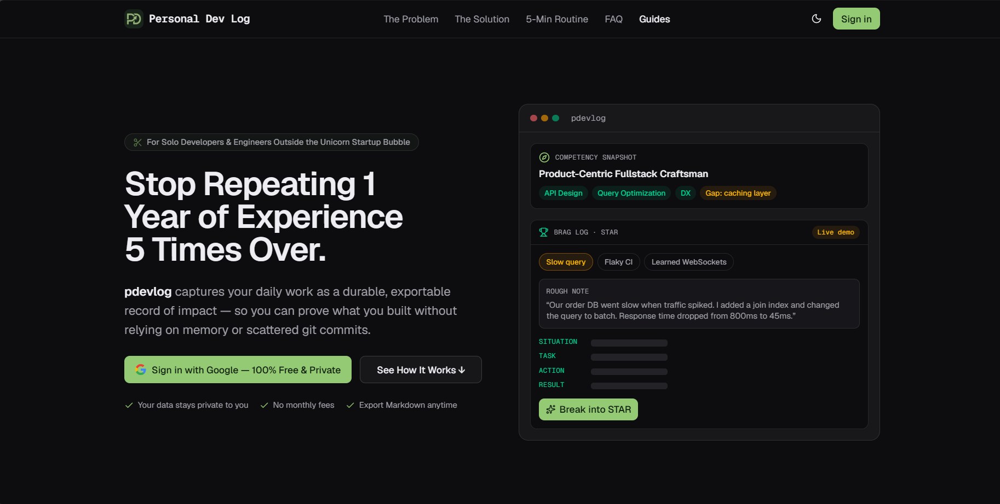

*The landing page doubles as the product tour: a raw note on the left, the same note shaped into STAR on the right.*

Every engineer has a year they cannot account for. Not because nothing
happened, but because the evidence never left the tools that owned it: the
ticket closed, the Slack thread got archived, the GitLab merge request is a
diff with no rationale. When an interview asks "what was the biggest impact you
made?", the honest answer is a shrug.

pdevlog is my answer to that. You write two sentences about your day, in
whatever language you think in, and the app shapes them into a STAR entry
(Situation, Task, Action, Result) that survives a performance review. Sparks
capture ideas from anywhere with `Cmd+K`. Notes keep the messy thinking.
Everything exports to Markdown or PDF, and deleting your account deletes your
rows.

The interesting part is not the feature list. It is the set of constraints
that made it small enough for one person to build and keep.

## What I refused to build

Three decisions constrained everything else:

- **No separate backend.** A worker and a React SPA, deployed together, no
  server to patch.
- **No database server.** D1 is SQLite at the edge; every row is scoped to a
  user and cascade-deleted with them.
- **No public storage bucket.** Screenshots and CV uploads are private by
  default, even at the URL level.

That rules out the usual "just add a service" reflex. There is no Redis for
rate limits, no background worker VM, no S3 bucket to configure.

## The shape of the system

```text
Cloudflare Worker "pdevlog"
├── ASSETS          static React SPA (Vite build), SPA fallback
├── /api/*          Hono router, runs worker-first
│   ├── D1 + Drizzle    users, workspaces, brag logs, notes, sparks, tags
│   ├── R2 (STORAGE)    spark screenshots, temporary CV uploads
│   └── Queues (AI_QUEUE)   slow AI jobs
└── / , /guides/*   worker-first for SEO landing pages
```

The client is React 19 + React Router + TanStack Query. The worker is Hono
with `@hono/zod-validator`, so every request boundary is typed, and the same
Zod schemas are shared with the client. Auth is Google OAuth with PKCE via
Arctic; the session is a signed `httpOnly` JWT cookie, never a token in
`localStorage`.

## Decision: the AI returns a contract, not prose

A chat box that answers in prose would have been trivial and useless — I need
fields, not paragraphs. So every AI call in pdevlog is a schema:

1. Take the Zod schema, convert it to JSON Schema with `zodResponseFormat`.
2. Put that JSON Schema **in the system prompt**, and ask for
   `response_format: { type: "json_object" }`.
3. Parse the answer with the same Zod schema before it touches the database.

Step 2 exists because the OpenAI-compatible endpoint I run against rejects
`json_schema` response formats outright. Sending the schema as text and
validating on the way out gets the same guarantee, minus the provider
cooperation — and it means I can swap `AI_BASE_URL` and `AI_MODEL` and keep
the same contract.

The failure mode matters more than the happy path. Bad JSON, a missing field,
a refusal — each throws a typed error, and the UI tells the user the draft
failed instead of writing half an entry. The prompt also forbids invented
metrics and tools: the model is there to structure what you did, not to
decorate it.

## Decision: slow AI work leaves the request path

Parsing a PDF CV with `unpdf` and running two analysis passes takes longer
than an HTTP request should. Those jobs go to a Cloudflare Queue
(`max_batch_size: 1`, `max_retries: 3`) while the request returns immediately
with a `processing` status.

The consumer is boring on purpose: load the user, do the work, delete the
temporary upload in a `finally`, and rethrow on failure so the queue retries.
If every attempt fails the profile is marked `failed` instead of hanging on a
spinner. And because a Worker isolate can be killed mid-job, the status
self-heals: anything stuck in `processing` for more than two minutes is
treated as stale on the next read.

## Decision: uploads never get a public URL

Screenshots and CVs live in R2, but nothing links to the bucket. Reads go
through an authenticated route that looks up the row by `id` **and** `userId`;
a URL that leaks into someone else's hands returns 404, not the image.

## Decision: rate limiting without new infrastructure

There is no KV or Durable Object in this stack for counters, so the limit is a
`Map` in the isolate: per-IP counters, expired keys swept at most once per
window instead of on every request, and a hard entry cap so a traffic spike
cannot grow the map without bound.

It is a per-isolate limit, not a global one — a real ceiling I accepted
because the endpoint it protects is login, and Cloudflare's own edge adds
coarse protection on top. If that stops being true, the upgrade path is a
Durable Object or KV counter, and the middleware signature would not change.

## The part I am most proud of: claims versus evidence

The "AI staff engineer" feature could have been a horoscope. Instead it runs
in two passes:

1. **Extraction.** The model reads the CV *and* recent devlog entries and
   separates what is proven by shipped work from what is only claimed in a
   skills list. Output: archetype, strengths with evidence, stack actually
   observed.
2. **Audit.** A second call plays principal engineer and names the blind
   spots that are missing entirely — reliability, data consistency,
   observability — with a concrete risk for each.

Splitting the passes is what keeps it honest. Asking one prompt to both
extract and criticize makes it flatter you. The verbatim-title rule on the
daily learning suggestion is the same idea: the model must quote the real
entries that inspired it, so a suggestion can always be traced back to actual
work.

## What I would change

- **Ship the boring journal first.** The STAR breakdown, competency audit, and
  changelog generator all sit behind the same wall: you need entries. A
  product that is valuable on day one has to work with an empty database.
- **Age out per-isolate state earlier.** The rate limiter is fine for login,
  but I would not reuse that pattern for anything correctness-critical.
- **Write the export path concurrently with the schema.** Export is the
  promise that makes storing personal data acceptable. Designing the Markdown
  shape alongside the tables would have avoided a refactor.

## Links

- Live: [pdevlog.farissbay.my.id](https://pdevlog.farissbay.my.id/)
- Source: [github.com/farissbayu/pdevlog](https://github.com/farissbayu/pdevlog)
